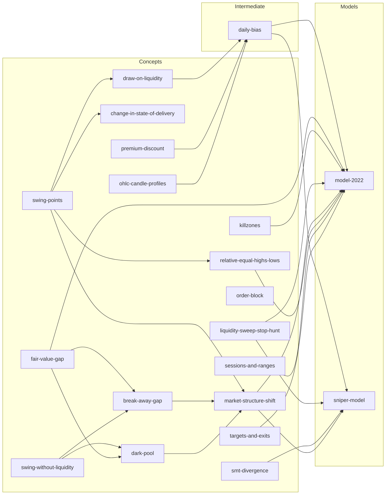

# ICT Trading Research

Futures trading research project implementing ICT (Inner Circle Trader) concepts on ES, NQ, and YM continuous contracts.

## What's in here

| Layer | Location | Purpose |
|---|---|---|
| **Concepts** | `concepts/` | One folder per concept — spec (markdown + YAML frontmatter), code, tests, analysis, charts, backtests colocated |
| **Models** | `models/` | The strategy layer — full models + intermediate gates, each a folder with code + spec + backtests/configs/results/examples |
| **Infrastructure** | `infrastructure/` | Installable shared machinery: `DataLoader`, the `@concept` registry, the backtest report engine, time utils |
| **Strategy notes** | `strategies/notes/` | Human write-ups extracted from video/PDF sources |
| **Data** | `Data/` | 1m continuous contracts for ES, NQ, YM (~1.1 GB, gitignored) |

## Setup

```bash
pip install -e .
```

Data files are not in the repo. Run the acquisition pipeline in `Data/prep/` with a Databento API key.

## Quick start

```python
from infrastructure import DataLoader

loader = DataLoader(timeframe='5T', weeks=52, data_dir='Data')
nq = loader.read_NQ()   # returns DataFrame with DatetimeIndex
es = loader.read_ES()
ym = loader.read_YM()
```

Timeframes: `'1T'` `'5T'` `'15T'` `'1H'` `'4H'` `'D'`

## Running a backtest

```bash
python backtests/fvg_sweep_backtest.py
# → results/fvg_sweep_<date>.html  (interactive Plotly report)
```

## Concepts (semantic + code layer)

Each concept lives in its own folder under `concepts/<author>/<category>/<name>/`, colocating its `<slug>.md` spec (machine-parseable YAML frontmatter + Detection Rules — the spec for the code beside it) with its `<name>.py` implementation, `tests/`, and `analysis/`. Slugs are bound to detector code via the `@concept("<slug>")` decorator; the registry (`infrastructure/registry.py`) globs specs from `concepts/` and `models/`. Import any detector flat: `from concepts import find_fvgs, SwingPointScanner`.

Currently implemented detectors: `swing-points`, `fair-value-gap`, `daily-bias`, `model-2022` (and more — see the lineage graph below).

See [concepts/ict/README.md](concepts/ict/README.md) for the ICT concept index.

## Models

| Model | File | Status |
|---|---|---|
| ICT 2022 (FVG sweep) | `models/ict/model_2022/` | backtested |
| Sniper Model | `models/ict/sniper_model/` | implemented |
| Silver Bullet | `models/ict/silver_bullet/` | spec only |
| Unicorn | `models/ict/unicorn/` | spec only |
| Three Indians / Wolfe Wave | `models/ict/three_indians/` | spec only |

## Concept Lineage

How concepts compose into models. Re-generate after adding new concepts:

```bash
python infrastructure/lineage.py                  # print full diagram
python infrastructure/lineage.py model-2022       # single model's graph
python infrastructure/lineage.py --update-readme  # regenerate the section below
```

<!-- lineage-start -->

<!-- lineage-end -->

## Disclaimer

For educational and research purposes only. Trading involves substantial risk of loss.
